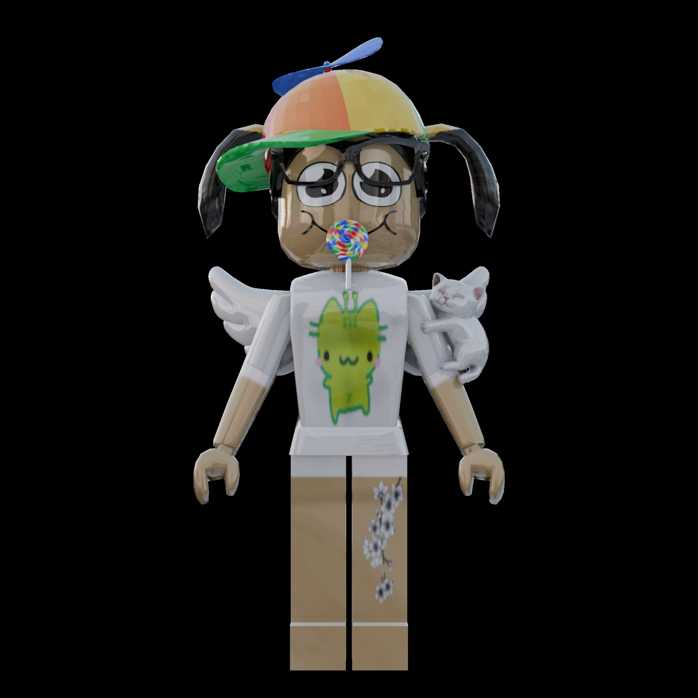

# Roblox Avatar Render Pipeline

Werte in [`Configs.toml`](Configs.toml) eintragen (Username, Drehung, Pose,
Bildausschnitt, Hintergrund), pushen, warten – und nach wenigen Minuten liegt
ein gläserner Avatar-Render als GitHub-Actions-Artifact bereit.

```
Configs.toml ──► UserId ──► Avatar-Definition ──► Assets
Posen.toml   ──► Rig-Pose (Grad pro Körperteil)     │
                                                    ▼
                                    RBXM-Modelle parsen (Mesh-/Textur-IDs)
                                                    │
                                                    ▼
                 render_avatar.png ◄── Blender 5.0 EEVEE (2000×2000, 16 Samples)
                    Artifact + Branch "renders" + Release
```

Accessoires und getragene Körperteile liefert Roblox als RBXM-**Modelle**
aus; die FileMesh-ID steckt erst darin. Ein eigener Parser
(`tools/rbxm.py`) extrahiert Mesh-/Textur-IDs, Größe und Position – erst
danach werden die echten Meshes geladen.


*Beispielausgabe (960×540, 64 Samples, Cycles CPU) mit dem neuen Material
(Texturen lesbar, Glas bleibt Glas). Gerendert mit dem Test-Rig und
synthetischen Accessoire-Meshes.

Vorher/Nachher am echten Avatar (`MertaStudios`):
[`docs/before_after.png`](docs/before_after.png)

## Schnellstart

1. **Secret hinterlegen:** Settings → Secrets and variables → Actions →
   `ROBLOX_OPEN_CLOUD_API_KEY` (Details und nötige Berechtigungen: **[ANLEITUNG.md](ANLEITUNG.md)**).
2. `Configs.toml` öffnen, Roblox-Usernamen eintragen (optional Drehung, Pose,
   Bildausschnitt und Hintergrund anpassen), committen, pushen.
3. Tab **Actions** → Lauf *Avatar-Render (Glas)* abwarten, bis der Punkt grün ist.
4. Ergebnis ansehen: Inline-Bild in der **Step Summary** des Laufs (geht auch
   auf dem Handy), im Branch [`renders`](../../blob/renders/latest.png)
   (`latest.png`) oder als Release
   [`avatar-render-latest`](../../releases/tag/avatar-render-latest).
   Alternativ unter **Artifacts** → `avatar-render` herunterladen
   (ZIP mit `render_avatar.png`; funktioniert nur im Browser, nicht in der
   iOS-App – Artifacts sind session-gebunden).

Der Schalter `render_bei_aenderung` in der `Configs.toml` entscheidet, ob ein
Push sofort rendert; nach einem erfolgreichen Render setzt der Workflow ihn
automatisch wieder auf `false`. Das Ergebnis des Workflows ist nur noch das
Bild – Analyse-/Diagnosedaten gibt es nur im Fehlerfall.

Ohne Secret läuft die Pipeline weiter, aber die Mesh-/Textur-Downloads schlagen
vermutlich fehl (401) – es wird dann ein Platzhalter-Körper gerendert.

## Was passiert im Workflow

| Schritt | Datei | Aufgabe |
| --- | --- | --- |
| 1 | `.github/workflows/avatar-render.yml` | Trigger, Secret, Blender-Installation, Artifact |
| 2 | `tools/build_avatar.py` | Orchestrierung: Username → UserId → Avatar → Rig |
| 3 | `tools/roblox_api.py` | Web-APIs + Asset Delivery (Open Cloud & Fallbacks) |
| 4 | `tools/rbxm.py` | RBXM-/RBXMX-Parser: Mesh-/Textur-IDs aus Modellen, kompletter Instanz-Baum für Emotes |
| 5 | `tools/roblox_mesh.py` | Roblox-`.mesh`-Parser (v1.00–v7.00) → OBJ |
| 6 | `tools/avatar_rig.py` | Stand-Pose-Rig, Accessoire-Platzierung |
| 7 | `tools/avatar_pose.py` | Posen aus `Posen.toml` auf das Rig anwenden |
| 7b | `tools/emote_pose.py` | Emote-Posen: Roblox-Emote per Asset-ID, Frame wie im Katalog-Vorschaubild |
| 8 | `tools/render_config.py` | `Configs.toml` lesen/prüfen (Grenzen, Render-Schalter) |
| 9 | `blender/render_glass.py` | Blender-5.0-EEVEE-Glossy-Material, World-HDRI (`sunset_jhbcentral_4k.exr`), Kamera mit Drehung/Bildausschnitt, Hintergrundbild, Render |
| 10 | `.github/workflows/avatar-render.yml` | Veröffentlichen: Artifact + Branch `renders` + Release |
| – | `tools/diagnose.py` | prüft Endpunkte/Key-Rechte (Workflow *Roblox-Diagnose*) |

Ergebnis im Build-Ordner: `manifest.json`, `parts/*.obj`, `textures/*`,
`summary.md` (nur Debug). Veröffentlicht wird ausschließlich das Bild.

## Einstellungen: `Configs.toml` und `Posen.toml`

| Wert | Bedeutung |
| --- | --- |
| `username` | Roblox-Username (früher `username.txt`) |
| `drehung_grad` | Seitliche Drehung `-90 … 90`; `0` = frontal, `90` = rechte Seite |
| `pose` | `None`, ein Name aus `Posen.toml`, ein Emote (`emote:<Asset-ID>`, z. B. `emote:3576893107`) **oder** die vom Account getragene Pose: `"ausgeruestet"` (Aliase `equipped`, `auto`, `getragen`; auch `"ausgerüstet"`), eingeschränkt auf `"ausgeruestet:emote"` bzw. `"ausgeruestet:idle"` |
| `emote_zeit` | `-1` (Standard) = automatisch der Frame aus dem Katalog-Vorschaubild (ThumbnailTime bzw. mittlerer benannter bzw. generierter Keyframe); `>= 0` = expliziter Zeitpunkt in Sekunden |
| `emote_datei` | leer = Emote über die Asset-ID laden; sonst Pfad zu einer lokalen `.rbxm`/`.rbxmx`-Emote-Datei |
| *(Bildausschnitt)* | Steht nicht mehr hier – jede Pose in `Posen.toml` definiert selbst, was sichtbar ist (`sichtbar_oben_prozent` / `sichtbar_unten_prozent`, Kamera-Abstand, Avatar-Höhe) |
| `render_bei_aenderung` | `true` = nach dem Push rendern (Workflow setzt danach auf `false`) |
| `hintergrund_url` | Bild-URL/Pfad, `"hdri"` (Standard) oder `"transparent"` |
| `hintergrund_glossy` | `true` = glänzend wie der Avatar, `false` = matt |
| `layered_clothing` | `"auslassen"` (Standard) = Layered Clothing wird nicht gerendert; `"starr"` = starr am Anker-Knochen mitgedreht |

In `Posen.toml` beschreibt jede Pose mit sprechenden Delta-Werten, wie sich
die Gelenke gegenüber der Stand-Pose verändern (z. B. am Oberarm
`vor_hoch_schwingen_grad` und `vom_koerper_weg_grad` statt roher Achsen-Tripel),
plus eigenem Bildausschnitt und Kamera-Abstand. Gedreht wird um die exakten
Gelenk-Pivots aus den RigAttachments; bei echten R15-Rigs wird jedes Segment
**starr** um sein Gelenk transformiert (Motor6D-Semantik wie in Roblox –
`part1 = part0 * C0 * Transform * C1⁻¹`), nur die Fallback-Quader ohne
Attachment-Daten werden volumen-erhaltend per Quaternionen überblendet.

**Ausgerüstete Pose** (`pose = "ausgeruestet"`): Die Pipeline liest die
Pose, die der Account gerade trägt, aus dem Avatar und wendet sie an – ohne
Asset-ID im Config-File. Reihenfolge: `PoseAnimation` (56) → `IdleAnimation`
(51) → ausgerüstete Emotes in Slot-Reihenfolge; die erste ladbare Variante
gewinnt. `"ausgeruestet:emote"` / `"ausgeruestet:idle"` grenzen die Quellen
ein, `emote_zeit` wählt den Frame. Welche Quelle genutzt wurde, steht im Log
(`ausgeruestet: …`) und im Manifest unter `render.pose_details`. Ein lokaler
Pfad in `emote_datei` hat Vorrang.



**Rig-Genauigkeit:** Jedes Segment hängt an seinen eigenen `RigAttachment`s –
exakt nach der Roblox-Regel `Kind = Eltern · C0 · C1⁻¹`. Einzelne Segmente
werden nie gestaucht oder gestreckt, die Naht zwischen zwei Segmenten bleibt zu,
und Gelenke sitzen dort, wo Roblox sie setzt:

* **Montage wie bei Roblox.** Jedes ausgerüstete Segment hängt über seine
  `*RigAttachment`s am Elternteil (`Kind = Eltern · C0 · C1⁻¹`) – Drehpunkte
  und Nähte sind damit exakt die des Spiels, und die Pose dreht um dieselben
  Gelenke. Es gibt **keine** Schulterlinien-Konstante und keine
  Längen-Normierung mehr: Die frühere „Schulterband“-Verschiebung setzte die
  Schultern zu hoch, ein späteres Ersetzen der Arme durch umgehängte
  Ersatzteile ließ Ober-/Unterarm und Hand im Emote auseinanderfliegen –
  beides ist entfernt.
* **Fehlende Körperteile = R15-Standard-Avatar.** Trägt der Avatar ein Teil
  gar nicht (z. B. keine Beine), setzt Roblox den **R15-Standard-Blocky** ein.
  Die Pipeline nutzt dafür exakt Roblox' offizielle Referenz
  `BlockyCharacter.fbx` (Doku: „Standard R15 rigs → Blocky", das Template mit
  „a standard R15 rig and attachments"): Geometrie, **Gelenke** und
  **Accessoire-Anker** (`reference/standard_r15_rig.json`, gebaut von
  `tools/standard_r15.py`). Die Ersatzteile werden genauso montiert wie
  ausgerüstete – `Kind = Eltern · C0 · C1⁻¹` –, die Pose dreht damit um die
  echten Roblox-Pivots, und Brillen/Hüte verschweissen exakt an
  `FaceFrontAttachment`/`HatAttachment` & Co. Keine geschaetzten
  Gelenkfraktionen, keine Schulterlinien-Konstante, kein einzelner Klotz.
* **Referenzdateien.** `tools/probe_reference.py` lädt Roblox' offizielle
  FBX-Dateien nach `reference/official/`, `tools/build_mannequin.py` macht
  daraus kompakte JSONs, die zur Renderzeit ohne FBX-Parser geladen werden:
  `standard_r15_rig.json` (Rig-Spezifikation des Standard-Avatars: Meshes,
  `*RigAttachment`-Gelenke, `*_Att`-Accessoire-Anker),
  `standard_r15.json` (Geometrie/Maße) und `classic_body.json` (klassischer
  Körper, nur noch als Maß-Abgleich – der Körper dieses Avatars ist klassisch,
  seine Teile stimmen mit `ClassicMannequin.fbx` überein).
* **Beine** behalten die Länge ihres Bundles (Roblox normiert nicht). Nur wenn
  linkes und rechtes Bein voneinander abweichen, wird das kürzere gleichmäßig
  angeglichen, damit beide Füße auf dem Boden stehen.

Alle Eingriffe stehen als `Rig-Audit:`-Warnung im Log und im Manifest
(`rig_audit` mit `joint_spans`, `gelenke`, `segmente`, `segment_rohdaten`); dazu
listet `assets` alle getragenen Assets und `fehlende_koerperteile` die
Teile, die durch den Standard-Avatar ersetzt wurden. Derselbe Block landet in der Step Summary des Render-Workflows.

**Emote-Posen** (`pose = "emote:<ID>"`): Die Pipeline lädt das Emote aus dem
Roblox-Katalog und wendet exakt die Haltung an, die auch das
Katalog-Vorschaubild zeigt – deterministisch über die Metadaten, die Roblox
selbst dafür im Emote-Asset ablegt (`ThumbnailKeyframe` bzw.
`ThumbnailTime`; ohne diese Werte gilt Roblox' eigene Fallback-Regel:
Mittel-Keyframe bzw. halbe Emote-Dauer). Klassische KeyframeSequence-Emotes
werden genauso unterstützt wie moderne UGC-CurveAnimations (inkl. der
Engine-Interpolation: konstant/linear/kubisch Hermite, Quaternion-Slerp).
Root-Bewegungen (HumanoidRootPart) fließen korrekt ein. Schlägt das Laden
fehlerhaft, wird automatisch die Stand-Pose gerendert und eine Warnung
geloggt – der Render bricht nie ab. Accessoires folgen automatisch – **Ausnahme: Ausrüstung (Gear,
Asset-Typ 19) wird gar nicht erst geladen.** Enthalten sind viele GFX-Posen,
z. B. `Helden_Pose`, `Siegerfaust`, `Kampfstellung`, `Superhelden_Landung`,
`Sprung_Action`, `Arme_Verschraenkt`, `Denker`, `Peace_Pose`, `Tanz_Freeze`,
`Flieger`, `Winken` und `hearthands`.

**`hearthands`** formt die Hände vor der Brust zu einem Herz. Falls Torso oder
Arme nicht bereits aus dem Roblox-„Woman“-Rig stammen, lädt die Pose gezielt
`Woman Torso`, `Woman Right Arm` und `Woman Left Arm` nach (die Arm-Assets
enthalten Oberarm, Unterarm und Hand); fremde Segmente dieser Slots werden
nicht mit dem Woman-Rig vermischt. Da R15-Hände keine einzelnen Finger-Bones
haben, bildet ein gemeinsamer Cage beide Hand-Meshes auf je eine Halbherz-
Silhouette ab – mit runden Loben, Kerbe oben und gemeinsamer Spitze unten.
Weiche Gelenk-Manschetten schließen die Zwischenräume zwischen Oberarm,
Unterarm und Hand; die Arme erhalten geweldete Smooth-Normalen. Der dichte
Bildausschnitt zeigt nur noch einen kleinen Teil der Beine. Die Posen-
Definition steht in `Posen.toml` und wird mit `pose = "hearthands"` aktiviert.

## Änderungen landen ohne Pull Request in `main`

[`auto-merge.yml`](.github/workflows/auto-merge.yml) merged **jeden Push auf
einen Arbeitsbranch** automatisch nach `main` – der Branch, auf den gepusht
wurde, ist die Quelle (`agent-changes`, `arena/<session-id>-…`, …). Es wird
**kein Pull Request** erstellt. Regeln für Agenten:
[AGENTS.md](AGENTS.md), Details: [ANLEITUNG.md](ANLEITUNG.md).

## Lokal ausprobieren

```bash
# nur den Körper bauen, ohne Netzwerk (nutzt Configs.toml)
python3 tools/build_avatar.py --dry-run --out build

# echten Avatar laden (Key optional, aber empfohlen)
export ROBLOX_OPEN_CLOUD_API_KEY="..."
python3 tools/build_avatar.py --config Configs.toml --username Builderman --out build

# rendern (Blender 5.0 muss installiert sein)
blender -b --factory-startup --python blender/render_glass.py -- \
  --manifest build/manifest.json --out render_avatar.png \
  --resolution 2000x2000 --samples 16
```

Verbindungs- und Key-Test (zeigt HTTP-Status aller Roblox-Endpunkte):

```bash
python3 tools/diagnose.py --username Builderman
```

Tests (ohne Netzwerk, ohne Blender):

```bash
pip install -r requirements-dev.txt
python3 -m pytest tools/tests -q
```

## Grenzen

* GitHub-Runner haben **keine physische GPU** → Blender 5.0 EEVEE rendert über Mesa Software-OpenGL/Vulkan (`llvmpipe`/`lavapipe`) mit 16 Samples in `2000x2000`.
* Roblox liefert **keinen** fertig geriggten Avatar als OBJ/GLB. Der Körper wird
  aus den Avatar-Farben/-Proportionen nachgebaut, Accessoires kommen als echte
  Meshes dazu und werden heuristisch an Kopf/Brust/Rücken/Händen platziert.
  Das Ergebnis ist eine künstlerische Näherung, kein 1:1-Abbild.
* Automatisierte Downloads fremder Avatare können gegen Roblox' Nutzungs-
  bedingungen verstoßen – bitte vorher prüfen (siehe ANLEITUNG.md).

Ausführlich: **[ANLEITUNG.md](ANLEITUNG.md)**
