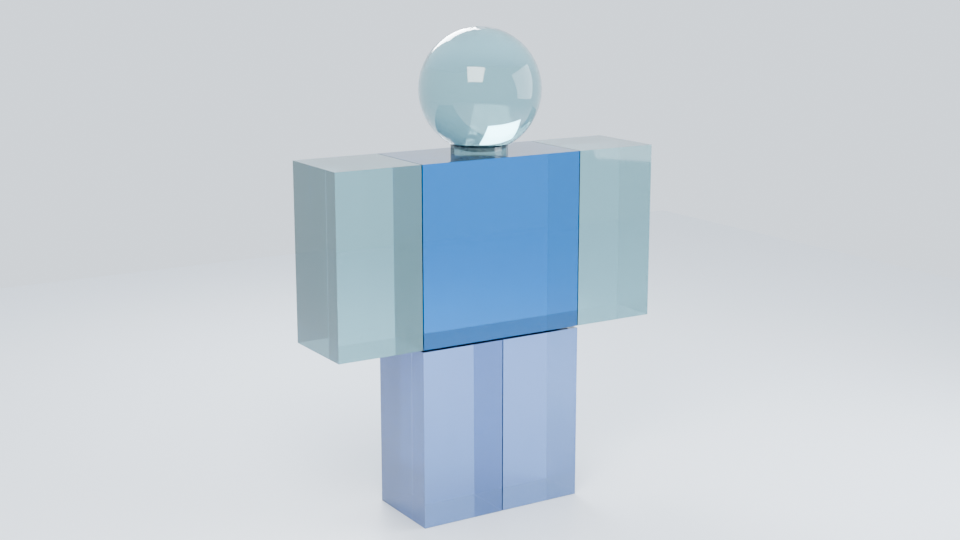

# Roblox Avatar Render Pipeline

Usernamen in [`username.txt`](username.txt) eintragen, pushen, warten – und nach
wenigen Minuten liegt ein gläserner Avatar-Render als GitHub-Actions-Artifact bereit.

```
username.txt  ──►  UserId  ──►  Avatar-Definition  ──►  Assets
                                                           │
                                        RBXM-Modelle parsen (Mesh-/Textur-IDs)
                                                           │
                             render_avatar.png  ◄──  Blender Cycles (CPU)
                                Artifact + Branch "renders" + Release
```

Accessoires und getragene Körperteile liefert Roblox als RBXM-**Modelle**
aus; die FileMesh-ID steckt erst darin. Ein eigener Parser
(`tools/rbxm.py`) extrahiert Mesh-/Textur-IDs, Größe und Position – erst
danach werden die echten Meshes geladen.



*Beispielausgabe (960×540, 64 Samples, Cycles CPU). Gerendert mit dem Test-Rig
und synthetischen Accessoire-Meshes – echte Avatare bringen ihre eigenen
Roblox-Meshes und Texturen mit.*

## Schnellstart

1. **Secret hinterlegen:** Settings → Secrets and variables → Actions →
   `ROBLOX_OPEN_CLOUD_API_KEY` (Details und nötige Berechtigungen: **[ANLEITUNG.md](ANLEITUNG.md)**).
2. `username.txt` öffnen, Roblox-Usernamen eintragen, committen, pushen.
3. Tab **Actions** → Lauf *Avatar-Render (Glas)* abwarten, bis der Punkt grün ist.
4. Ergebnis ansehen: Inline-Bild in der **Step Summary** des Laufs (geht auch
   auf dem Handy), im Branch [`renders`](../../blob/renders/latest.png)
   (`latest.png`) oder als Release
   [`avatar-render-latest`](../../releases/tag/avatar-render-latest).
   Alternativ unter **Artifacts** → `avatar-render` herunterladen
   (ZIP mit `render_avatar.png`; funktioniert nur im Browser, nicht in der
   iOS-App – Artifacts sind session-gebunden).

Ohne Secret läuft die Pipeline weiter, aber die Mesh-/Textur-Downloads schlagen
vermutlich fehl (401) – es wird dann ein Platzhalter-Körper gerendert.

## Was passiert im Workflow

| Schritt | Datei | Aufgabe |
| --- | --- | --- |
| 1 | `.github/workflows/avatar-render.yml` | Trigger, Secret, Blender-Installation, Artifact |
| 2 | `tools/build_avatar.py` | Orchestrierung: Username → UserId → Avatar → Rig |
| 3 | `tools/roblox_api.py` | Web-APIs + Asset Delivery (Open Cloud & Fallbacks) |
| 4 | `tools/rbxm.py` | RBXM-/RBXMX-Parser: Mesh-/Textur-IDs aus Modellen |
| 5 | `tools/roblox_mesh.py` | Roblox-`.mesh`-Parser (v1.00–v7.00) → OBJ |
| 6 | `tools/avatar_rig.py` | Stand-Pose-Rig, Accessoire-Platzierung |
| 7 | `blender/render_glass.py` | Cycles-Glasmaterial, Kamera, Licht, Render |
| 8 | `.github/workflows/avatar-render.yml` | Veröffentlichen: Artifact + Branch `renders` + Release |
| – | `tools/diagnose.py` | prüft Endpunkte/Key-Rechte (Workflow *Roblox-Diagnose*) |

Ergebnis im Build-Ordner: `manifest.json`, `parts/*.obj`, `textures/*`,
`summary.md` (landet in der GitHub-Step-Summary).

## Änderungen landen ohne Pull Request in `main`

[`auto-merge.yml`](.github/workflows/auto-merge.yml) merged **jeden Push auf
einen Arbeitsbranch** automatisch nach `main` – der Branch, auf den gepusht
wurde, ist die Quelle (`agent-changes`, `arena/<session-id>-…`, …). Es wird
**kein Pull Request** erstellt. Regeln für Agenten:
[AGENTS.md](AGENTS.md), Details: [ANLEITUNG.md](ANLEITUNG.md).

## Lokal ausprobieren

```bash
# nur den Körper bauen, ohne Netzwerk
python3 tools/build_avatar.py --dry-run --out build

# echten Avatar laden (Key optional, aber empfohlen)
export ROBLOX_OPEN_CLOUD_API_KEY="..."
python3 tools/build_avatar.py --username Builderman --out build

# rendern (Blender 4.2 muss installiert sein)
blender -b --factory-startup --python blender/render_glass.py -- \
  --manifest build/manifest.json --out render_avatar.png \
  --resolution 1280x720 --samples 64
```

Verbindungs- und Key-Test (zeigt HTTP-Status aller Roblox-Endpunkte):

```bash
python3 tools/diagnose.py --username Builderman
```

Tests (ohne Netzwerk, ohne Blender):

```bash
pip install -r requirements-dev.txt
python3 -m pytest tools/tests -q
```

## Grenzen

* GitHub-Runner haben **keine GPU** → Cycles rendert auf der CPU, 2–10 Minuten
  bei 720p/64 Samples.
* Roblox liefert **keinen** fertig geriggten Avatar als OBJ/GLB. Der Körper wird
  aus den Avatar-Farben/-Proportionen nachgebaut, Accessoires kommen als echte
  Meshes dazu und werden heuristisch an Kopf/Brust/Rücken/Händen platziert.
  Das Ergebnis ist eine künstlerische Näherung, kein 1:1-Abbild.
* Automatisierte Downloads fremder Avatare können gegen Roblox' Nutzungs-
  bedingungen verstoßen – bitte vorher prüfen (siehe ANLEITUNG.md).

Ausführlich: **[ANLEITUNG.md](ANLEITUNG.md)**
